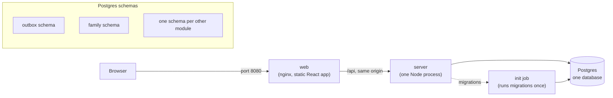

# Architecture overview

Offgrid is a self-hosted app suite. It runs as one server process with one Postgres database on the user's own machine. This page describes how the parts fit together and where each concern lives. The decisions behind it are in the [architecture decision records](../adr/README.md).

## Shape of the system

- **Modular monolith** ([ADR 0006](../adr/0006-modular-monolith.md)). One server process (`apps/main-server`) loads every feature module in `modules/`. Modules are separate in code and in the database, but they are deployed together.
- **One Postgres database** ([ADR 0009](../adr/0009-table-ownership-scopes.md)). Each module owns one schema, for example `family`. Each module has its own database roles, and it touches only its own schema.
- **Events, not calls** ([ADR 0002](../adr/0002-outbox-events-and-projections.md), [ADR 0010](../adr/0010-pluggable-event-transport.md)). A module that changes data writes a versioned event to the `outbox` schema in the same transaction as the change. Other modules react to that event through their own subscribers, with retries and a dead-letter queue for events that keep failing.
- **Read-only projections** ([ADR 0013](../adr/0013-projections-for-other-modules-only.md)). When a module needs data from another module, it keeps its own read-only copy, built from events. It never reads another module's tables.
- **Web app and API** ([ADR 0015](../adr/0015-no-reverse-proxy-cors-on-the-server.md)). A React + Vite web app is served as static files. It calls the server's HTTP API directly. A long-lived response, the notification stream at `/api/me/notifications/stream`, must not be buffered by any proxy placed in front of the server; the server sends `x-accel-buffering: no` for it. The server accepts browser requests only from the origins it is configured with. This is a browser rule, not an access control: it does not stop other clients.

- **Updater** ([ADR 0032](../adr/0032-outbound-update-check-and-image-pull.md)). `apps/updater` is a separate container with an internal-only HTTP API on port 3100. It is the only container that mounts the Docker socket. It checks for a release, takes a backup, pulls images by digest, runs the migration job, replaces the containers and rolls back when a step fails. It is an app, not a module, so it has no schema and no events. The `system` module (`modules/system`) holds the admin update API and reaches it over HTTP with a shared bearer token. Update requests are not events.

## Diagram

## Module layout

Each folder in `modules/` is one feature module (`@offgrid/<name>`). The standard layout is in [modules/README.md](../../modules/README.md), and `modules/family` is the reference implementation for the layers. The code lives under `modules/<name>/src/`:

- `domain/`: pure business logic, with no I/O.
- `application/`: commands and queries (use cases).
- `infrastructure/`: repositories and migrations for the module's own schema.
- `http/`: Fastify routes.
- `events/`: events the module publishes and handles.
- `workers/`: background jobs.
- `index.ts`: the only public entry point.

Inside a layer, files are grouped into feature subfolders (for example `application/sessions/`). `modules/identity` shows the grouping; the convention is in [modules/README.md](../../modules/README.md).

`apps/main-server` wires the modules together. `packages/` holds code that every module can use: contracts, the event bus, database helpers, access control, observability, the HTTP error model, the UI kit and the API client. Packages never import from apps or modules (rule `packages-not-import-apps-or-modules`).

The rules are enforced by `pnpm check:boundaries`. See [boundaries.md](boundaries.md).

## Request flow

1. The browser loads the web app from the `web` service on `OFFGRID_WEB_PORT` (default 8080).
2. The web app calls the API at `/api` on the same origin, using the typed client in `packages/api-client`. The web container's nginx forwards `/api` to the server on the Compose network.
3. The server routes the request to a module's `http/` routes. Cross-origin requests are checked against `OFFGRID_CORS_ORIGINS`.
4. The module runs its use case in a database transaction. It sets the request context (user or family) so that Postgres row policies apply. Today there is no sign-in: the server builds an anonymous context for every request, so user-scoped routes return `UNAUTHENTICATED`. The identity module that will supply the user is still an empty stub.
5. If the use case changed data that other modules care about, the same transaction writes an event to the outbox. Subscribers pick it up after the commit.

## Where each concern lives

| Concern                       | Where                                                                                                  |
| ----------------------------- | ------------------------------------------------------------------------------------------------------ |
| Containers and first-run init | `infra/compose/` (Docker Compose), `infra/init/` (database init SQL)                                   |
| Server composition            | `apps/main-server/src/`                                                                                |
| Web app                       | `apps/main-web/`                                                                                       |
| Updates and rollback          | `apps/updater/` (updater container, Docker runner, release source, backups)                            |
| Feature logic                 | `modules/<name>/`                                                                                      |
| Database schemas and roles    | `packages/db/` (helpers and migration runner), each module's `infrastructure/migrations`               |
| Events and subscribers        | `packages/event-bus/` (outbox, delivery, retries, dead letters), `packages/contracts/` (event schemas) |
| Access checks                 | `packages/access-control/`                                                                             |
| Logs and trace ids            | `packages/observability/`                                                                              |
| Shared API types              | `packages/contracts/` (schemas and OpenAPI), `packages/api-client/` (typed client)                     |
| End-to-end tests              | `e2e/` (Playwright-BDD, [ADR 0007](../adr/0007-e2e-playwright-bdd.md))                                 |

## Related

- [Module boundaries](boundaries.md)
- [Glossary](../glossary.md)
- [Privacy statement](../privacy.md)
- [Architecture decision records](../adr/README.md)
